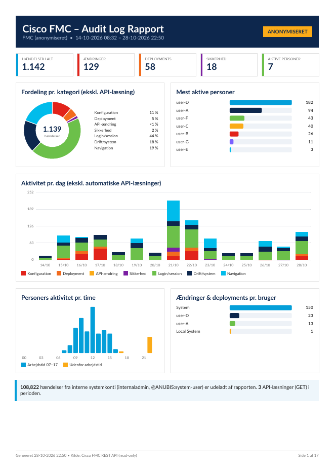
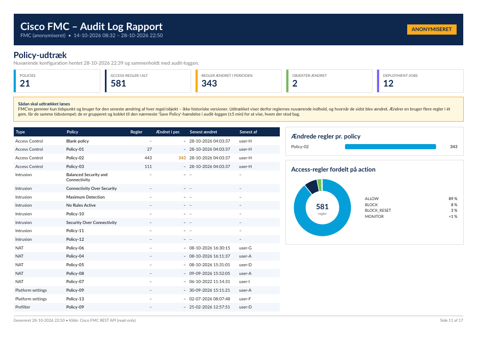

# FMC Audit Log → PDF

Henter audit-loggen fra en Cisco FMC via REST API (**kun læsning** – der laves ingen ændringer på FMC'en) og genererer en PDF-rapport med QuestPDF.

## Eksempel

Se en anonymiseret eksempelrapport: [docs/eksempel-rapport-anonymiseret.pdf](docs/eksempel-rapport-anonymiseret.pdf) (17 sider).

| Forside | Policy-udtræk |
|---|---|
|  |  |

## Opsætning

Kræver .NET 10 SDK. Credentials til FMC'en gemmes i **.NET user-secrets**, så der ikke ligger kodeord i klartekst
i projektmappen. De ligger i din brugerprofil (`~/.microsoft/usersecrets/<UserSecretsId>/secrets.json` på macOS/Linux,
`%APPDATA%\Microsoft\UserSecrets\<UserSecretsId>\secrets.json` på Windows) og kommer aldrig med i git.

Kør kommandoerne i projektmappen:

```bash
dotnet user-secrets set "Fmc:Host" "10.0.0.10"          # IP eller DNS-navn på FMC'en
dotnet user-secrets set "Fmc:Username" "api-user"       # helst en dedikeret API-bruger med read-only rolle
dotnet user-secrets set "Fmc:Password" "<kodeord>"
dotnet user-secrets list                                # kontrollér opsætningen
```

Tip: Tilføj et mellemrum foran kommandoen med kodeordet, så den ikke gemmes i shell-historikken (bash/zsh med
`HISTCONTROL=ignorespace` / `setopt HIST_IGNORE_SPACE`).

Valgfrit:

```bash
dotnet user-secrets set "Fmc:ExcludeUsers:0" "internaladmin"         # brugere der udelades (overskriver standard)
dotnet user-secrets set "Fmc:ExcludeUsers:1" "@ANUBIS:system-user"
dotnet user-secrets set "Fmc:AnonymizeTerms:0" "<kundenavn>"          # ekstra ord der skjules ved --anonymize
```

Alternativt kan værdierne sættes som miljøvariabler med prefix `FMCAUDIT_`, fx `FMCAUDIT_Fmc__Host=10.0.0.10`.

## Brug

```bash
dotnet run -- --days 30                     # hent fra FMC, gem i auditlog-cache.json og lav PDF
dotnet run -- --from-json                   # lav PDF ud fra cachen (hurtigt, ingen FMC-kald)
dotnet run -- --from-json --anonymize       # anonymiseret PDF til fremvisning
dotnet run -- --policy-only                 # hent kun policy-udtræk til policy-cache.json
dotnet run -- --from-json --no-policy       # rapport uden policy-udtræk
dotnet run -- --help                        # alle muligheder
```

`internaladmin` og `@ANUBIS:system-user` udelades som standard (brug `--include-all` for at få dem med,
eller sæt `Fmc:ExcludeUsers` i user-secrets). Ekstra ord, der skal skjules ved anonymisering, kan sættes i `Fmc:AnonymizeTerms`.

FMC'en returnerer højst ca. 100 records pr. forespørgsel, så klienten bladrer bagud i tid med `endtime`.

## Policy-udtræk

Rapporten indeholder et policy-udtræk (kun GET-kald): policies, access-regler ændret i perioden (nuværende indhold,
grupperet pr. gem og koblet til nærmeste "Save Policy"-hændelse i audit-loggen), objekter ændret i perioden og
deployment-historik med enheder/versioner. FMC'en gemmer kun seneste ændringstidspunkt pr. regel/objekt, så tidligere
versioner kan ikke vises. Udtrækket hentes automatisk ved live-kørsel og gemmes i `policy-cache.json`, som bruges af `--from-json`.

`auditlog-cache.json` og `policy-cache.json` indeholder rå (ikke-anonymiserede) data og bør ikke deles.
