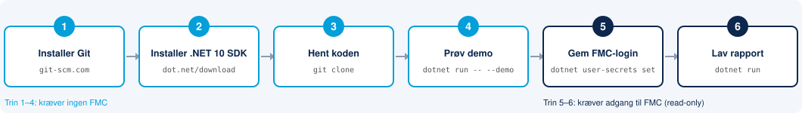
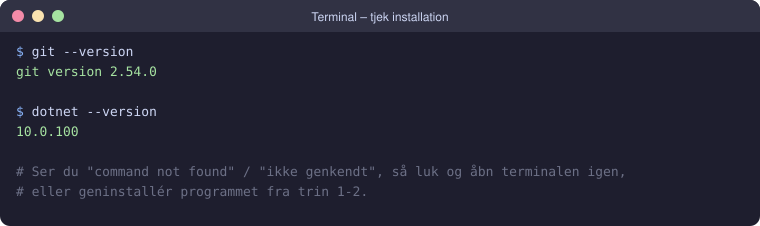
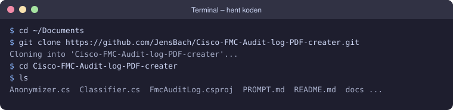
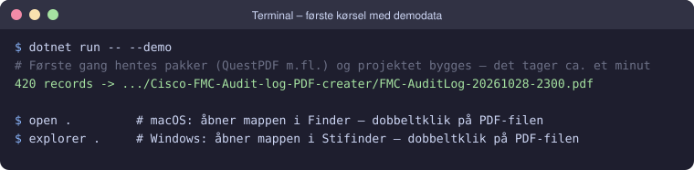
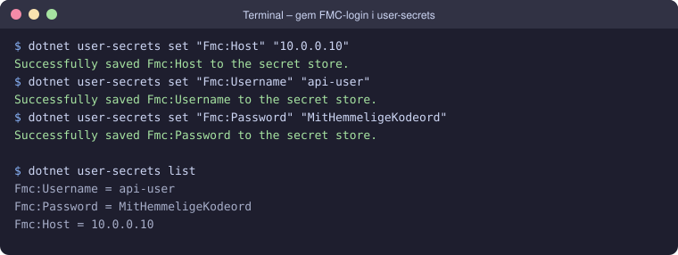
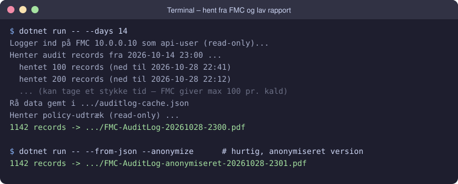

# FMC Audit Log → PDF

Henter audit-loggen fra en Cisco FMC via REST API (**kun læsning** – der laves ingen ændringer på FMC'en) og genererer en PDF-rapport med QuestPDF.

## Eksempel

Se en anonymiseret eksempelrapport: [docs/eksempel-rapport-anonymiseret.pdf](docs/eksempel-rapport-anonymiseret.pdf) (17 sider).

| Forside | Policy-udtræk |
|---|---|
|  |  |

## 🚀 Kom godt i gang – guide for begyndere

Har du aldrig brugt Git eller .NET før? Så følg trinene herunder. Det tager ca. 15 minutter, og trin 1–4 kan laves uden adgang til en FMC.



### Trin 0 – Åbn en terminal

Alle kommandoer i guiden skrives i en *terminal* (et vindue, hvor man skriver kommandoer). Skriv kommandoen og tryk **Enter**.

| Windows | macOS |
|---|---|
| Tryk på **Start**-knappen, skriv `Terminal` (eller `PowerShell`) og tryk Enter. | Tryk **⌘ Cmd + Mellemrum**, skriv `Terminal` og tryk Enter. |

> 💡 `$` foran kommandoerne på billederne skal **ikke** skrives med. Den viser bare, at det er en kommando.

### Trin 1 – Installer Git

Git bruges til at hente koden fra GitHub.

- **Windows:** Hent installeren fra <https://git-scm.com/download/win> og klik **Next** hele vejen igennem (standardvalgene er fine).
  Har du `winget`, kan du i stedet skrive `winget install --id Git.Git -e`.
- **macOS:** Skriv `xcode-select --install` i terminalen og klik **Installér** i vinduet, der dukker op.
  Har du [Homebrew](https://brew.sh), kan du i stedet skrive `brew install git`.

### Trin 2 – Installer .NET 10 SDK

.NET er den platform, programmet er skrevet i. SDK'en indeholder alt, hvad der skal til for at bygge og køre det.

1. Gå til <https://dotnet.microsoft.com/download/dotnet/10.0>.
2. Under **SDK** vælger du installeren til dit styresystem:
   - **Windows:** *x64* (de fleste pc'er). Har du en ARM-pc, fx Surface med Snapdragon, skal du vælge *Arm64*.
   - **macOS:** *Arm64* på Mac med Apple-chip (M1–M4) og *x64* på ældre Intel-Mac. Se under  → *Om denne Mac*.
3. Kør installeren, og klik dig igennem.
   (Windows med `winget`: `winget install Microsoft.DotNet.SDK.10`. macOS med Homebrew: `brew install --cask dotnet-sdk`.)

> ⚠️ Vælg **SDK** og ikke *Runtime*. Runtime kan kun køre færdige programmer, ikke bygge dem.

**Luk terminalen og åbn den igen**, så den opdager de nye programmer. Tjek derefter, at begge dele virker:



Versionsnumrene kan være lidt anderledes hos dig. Det vigtige er, at `dotnet --version` starter med **10**.

### Trin 3 – Hent koden

Gå til den mappe, hvor projektet skal ligge (her *Dokumenter*), og hent koden:

```bash
cd ~/Documents
git clone https://github.com/JensBach/Cisco-FMC-Audit-log-PDF-creater.git
cd Cisco-FMC-Audit-log-PDF-creater
```



> Uden Git: Klik på den grønne **Code**-knap øverst på GitHub-siden → **Download ZIP**, og pak filen ud. Du skal stadig bruge .NET (trin 2).
>
> På Windows virker `cd ~/Documents` i PowerShell og Terminal. I den gamle *Kommandoprompt* skal du skrive `cd %USERPROFILE%\Documents`.

### Trin 4 – Prøv med demodata (ingen FMC nødvendig)

Nu kan du lave en rapport med opdigtede data og se, at alt virker:

```bash
dotnet run -- --demo
```



Første gang henter .NET automatisk de pakker, projektet bruger (fx QuestPDF), og bygger programmet. Det tager et øjeblik.
Bagefter ligger der en PDF-fil i projektmappen. Åbn mappen med `open .` (macOS) eller `explorer .` (Windows), og dobbeltklik på PDF'en.

### Trin 5 – Gem login til FMC'en sikkert (user-secrets)

Før du kan hente rigtige data, skal du have:

- **Netværksadgang** til FMC'en fra din computer (fx via VPN).
- **En bruger på FMC'en til API'et.** Brug helst en dedikeret bruger med en **read-only rolle**, fx *Security Analyst (Read Only)*.
- **REST API slået til** på FMC'en. Det står under *System (⚙) → Configuration → REST API Preferences*, og din FMC-administrator kan hjælpe.

Login gemmes med **.NET user-secrets**. Det er et lille, privat lager i din brugerprofil, så kodeordet **ikke** ligger i projektmappen og aldrig kommer med op på GitHub.
Skriv kommandoerne i projektmappen, og udskift værdierne med dine egne:

```bash
dotnet user-secrets set "Fmc:Host" "10.0.0.10"
dotnet user-secrets set "Fmc:Username" "api-user"
dotnet user-secrets set "Fmc:Password" "MitHemmeligeKodeord"
dotnet user-secrets list
```



> 💡 Indeholder kodeordet specialtegn som `$`, `!` eller `"`, skal du bruge enkelte anførselstegn på macOS/Linux, fx `'Mit$Kode!'`.

### Trin 6 – Lav rapporten

```bash
dotnet run -- --days 14
```



Programmet laver **kun læsninger (GET)** på FMC'en og ændrer intet. Første hentning kan tage lidt tid, fordi FMC'en kun udleverer ca. 100 hændelser ad gangen.
Data gemmes i `auditlog-cache.json` og `policy-cache.json`. Bagefter kan du lave nye PDF'er på få sekunder uden at spørge FMC'en igen:

```bash
dotnet run -- --from-json                 # rigtig rapport ud fra gemte data
dotnet run -- --from-json --anonymize     # anonymiseret rapport, som kan vises frem
dotnet run -- --from-json --out rapport.pdf   # vælg selv filnavn
```

> ⚠️ Cache-filerne og den rigtige PDF indeholder følsomme data (brugere, IP'er og regler). Del kun den anonymiserede PDF.

### Fejlfinding

| Problem | Løsning |
|---|---|
| `git` eller `dotnet` "not found" / "ikke genkendt" | Luk og åbn terminalen igen efter installationen. Hjælper det ikke, så genstart computeren. |
| `dotnet --version` viser 8 eller 9 | Installer .NET **10 SDK** (trin 2). Flere versioner kan sagtens være installeret side om side. |
| "Couldn't find a project to run" | Du står i den forkerte mappe. Skriv `cd Cisco-FMC-Audit-log-PDF-creater`. |
| "Mangler credentials" | Trin 5 mangler, eller kommandoen blev kørt i en anden mappe end projektmappen. |
| 401 Unauthorized | Forkert brugernavn eller kodeord, eller brugeren har ikke adgang til REST API. |
| Timeout / ingen forbindelse | Tjek VPN/netværk, og om du kan åbne `https://<fmc-ip>` i en browser. |
| Certifikatfejl med `--strict-tls` | FMC'en bruger et selvsigneret certifikat. Kør uden `--strict-tls`. |

---

## Opsætning (kort version)

Kræver .NET 10 SDK. Credentials til FMC'en gemmes i **.NET user-secrets**, så der ikke ligger kodeord i klartekst
i projektmappen. De ligger i din brugerprofil (`~/.microsoft/usersecrets/<UserSecretsId>/secrets.json` på macOS/Linux,
`%APPDATA%\Microsoft\UserSecrets\<UserSecretsId>\secrets.json` på Windows) og kommer aldrig med i git.

Kør kommandoerne i projektmappen:

```bash
dotnet user-secrets set "Fmc:Host" "10.0.0.10"          # IP eller DNS-navn på FMC'en
dotnet user-secrets set "Fmc:Username" "api-user"       # helst en dedikeret API-bruger med read-only rolle
dotnet user-secrets set "Fmc:Password" "<kodeord>"
dotnet user-secrets list                                # kontrollér opsætningen
```

Tip: Tilføj et mellemrum foran kommandoen med kodeordet, så den ikke gemmes i shell-historikken (bash/zsh med
`HISTCONTROL=ignorespace` / `setopt HIST_IGNORE_SPACE`).

Valgfrit:

```bash
dotnet user-secrets set "Fmc:ExcludeUsers:0" "internaladmin"         # brugere der udelades (overskriver standard)
dotnet user-secrets set "Fmc:ExcludeUsers:1" "@ANUBIS:system-user"
dotnet user-secrets set "Fmc:AnonymizeTerms:0" "<kundenavn>"          # ekstra ord der skjules ved --anonymize
```

Alternativt kan værdierne sættes som miljøvariabler med prefix `FMCAUDIT_`, fx `FMCAUDIT_Fmc__Host=10.0.0.10`.

## Brug

```bash
dotnet run -- --days 30                     # hent fra FMC, gem i auditlog-cache.json og lav PDF
dotnet run -- --from-json                   # lav PDF ud fra cachen (hurtigt, ingen FMC-kald)
dotnet run -- --from-json --anonymize       # anonymiseret PDF til fremvisning
dotnet run -- --policy-only                 # hent kun policy-udtræk til policy-cache.json
dotnet run -- --from-json --no-policy       # rapport uden policy-udtræk
dotnet run -- --help                        # alle muligheder
```

`internaladmin` og `@ANUBIS:system-user` udelades som standard (brug `--include-all` for at få dem med,
eller sæt `Fmc:ExcludeUsers` i user-secrets). Ekstra ord, der skal skjules ved anonymisering, kan sættes i `Fmc:AnonymizeTerms`.

FMC'en returnerer højst ca. 100 records pr. forespørgsel, så klienten bladrer bagud i tid med `endtime`.

## Policy-udtræk

Rapporten indeholder et policy-udtræk (kun GET-kald): policies, access-regler ændret i perioden (nuværende indhold,
grupperet pr. gem og koblet til nærmeste "Save Policy"-hændelse i audit-loggen), objekter ændret i perioden og
deployment-historik med enheder/versioner. FMC'en gemmer kun seneste ændringstidspunkt pr. regel/objekt, så tidligere
versioner kan ikke vises. Udtrækket hentes automatisk ved live-kørsel og gemmes i `policy-cache.json`, som bruges af `--from-json`.

`auditlog-cache.json` og `policy-cache.json` indeholder rå (ikke-anonymiserede) data og bør ikke deles.

## Licens

Koden er udgivet under [MIT-licensen](LICENSE). Alle må frit bruge, kopiere, ændre og videredistribuere programmet,
også kommercielt, så længe licensteksten følger med. Programmet leveres "som det er" uden garanti.

**Bemærk om QuestPDF:** PDF'en laves med [QuestPDF](https://www.questpdf.com), som har sin egen licens. Programmet bruger
QuestPDF's *Community License*, som er gratis for bl.a. privatpersoner, open source-projekter og virksomheder med under
1 mio. USD i årlig omsætning. Større virksomheder, der bruger programmet i drift, skal selv have en
[QuestPDF Professional- eller Enterprise-licens](https://www.questpdf.com/license/). Læs QuestPDF's
[guide til licensvalg](https://www.questpdf.com/license/guide.html).
